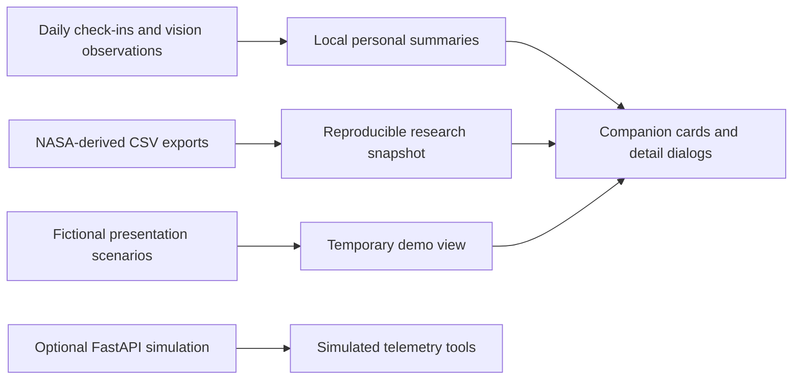

# BioTelemetry

### A space-health companion connecting daily astronaut wellbeing with NASA research.

BioTelemetry brings a daily wellness log, a research explorer, and simulated biotelemetry into one workspace. A crew member can record how they feel, review changes over time, and inspect the evidence behind health research in space.

The project is a hackathon prototype. It uses public NASA-derived datasets and independently built software. It is not a NASA-operated or NASA-endorsed medical system.

## The problem we address

Daily wellness observations and scientific datasets serve different purposes. A sleep entry describes someone's experience; an experiment describes a particular study population. Simply placing them on the same screen can make a research result look like a personal diagnosis.

BioTelemetry keeps those sources visible and separate. It connects an observation to a relevant research topic, then lets the user inspect the study, species, group measurements, source files, and limitations.

## What the system does

| Area | User experience | Source |
| --- | --- | --- |
| Radiation & Space Weather | Replay solar flares, particle-event entries, and geomagnetic activity by historical date. | Local NASA DONKI catalog exports. |
| Vision Health | Record a dated vision observation and review its history. Open the related eye-health research. | User observations; OSDR ocular datasets and NASA SANS research. |
| Bone & Muscle Maintenance | Review completed exercise, days with activity entries, and reported discomfort. | Daily check-ins; reduced-loading animal experiments. |
| Recovery & Wellbeing | Review recorded sleep, fatigue, stress, mood, and changes between entries. | Daily check-ins; NASA sleep research and separately labeled clinical study context. |

The main workspace also includes:

- **Daily check-in:** three steps for sleep, wellbeing, and physical activity. Drafts survive reloads and are separated by astronaut.
- **Health trends:** charts and dated history built from saved entries, including optional discomfort, social wellbeing, and sleep timing.
- **Daily activities:** reversible, per-astronaut activity records for the current local day.
- **Research dialogs:** open a focus card to inspect observations alongside source evidence, with keyboard navigation and source links.
- **Presentation demo:** three fictional seven-day scenarios that leave personal records untouched.
- **Telemetry tools:** simulated vital signs, ECG, notifications, anomaly scenarios, diagnostics, and an offline telemetry queue.
- **Assistant:** a deterministic demo adapter that explains selected saved context. No external AI model is connected.

## Try the demonstration

After each refresh, a welcome dialog introduces the workspace until you select **Don’t show again**. Select **Show me around** for a five-step guided tour. It highlights the daily check-in button, a focus card, presentation demo controls, navigation, and crew selector. Use **Next**, **Back**, or **Skip the tour**. The last step can open your first check-in or leave you on Home.

Select **How it works** in the top utility bar, or the sidebar introduction card, to replay the welcome and tour at any time. Only the **Don’t show again** checkbox saves an opt-out preference in this browser. Starting, finishing, or skipping the tour does not suppress future welcomes. Uncheck it through How it works to restore the welcome after refresh. This preference does not alter health records. If preferences cannot be saved, a message explains the failure and the welcome continues appearing. The tour points out controls; it does not enter answers or start a scenario on your behalf.

1. Open **Home** and select **Start demo** in the companion panel.
2. Choose **Steady week**, **Demanding week**, or **Recovery week**.
3. Move the day slider from 1 to 7. Watch the sleep, exercise, fatigue, and vision observations change.
4. Open a card to inspect its observations and the relevant research. Close the dialog with **Done**, the close button, or **Escape**.
5. Open **Radiation & Space Weather** and explore the historical date controls. The opening example is May 11, 2024, a maximum-Kp day in the local snapshot.
6. Select **Exit demo** to return to personal records.

Demo observations are invented presentation fixtures. They are not NASA participant data or medical estimates. They are never inserted into personal storage or sent to the API. The other app pages continue to use saved personal records. Leaving Home or changing astronaut ends the temporary scenario.

## How the data connects



The connection is topic-based: exercise entries open bone-and-muscle research; vision observations open ocular research. There is no trained model assigning study results to the selected crew member.

Seven-day companion summaries use the latest check-in from each local calendar day. Multiple entries on one day do not inflate exercise totals. Missing days remain unknown. Recovery differences compare saved entries and do not establish a cause.

## NASA data and evidence limits

The local research snapshot was captured on **November 14, 2026**. It is bundled with the frontend for offline access after the production app has been cached.

| Local data | What is available | How it is used |
| --- | --- | --- |
| `backend/data/donki/` | Flare, solar energetic particle, geomagnetic-storm, and daily-summary exports. Daily bins cover January 1, 2020 through November 14, 2026. | Historical environmental replay. A missing entry is not a confirmed safe or quiet condition. |
| `backend/data/osdr/ocular_sans.csv` | 2,431 measurement rows across five study IDs, with mixed or unspecified organisms. | The featured OSD-583 eye-pressure comparison uses mouse samples. It cannot diagnose human SANS. |
| `backend/data/osdr/bone_muscle.csv` | 24,716 measurement rows across ten study IDs; mice and rats. | The featured OSD-608 comparison describes four-week bone-density changes in rats under partial loading. It does not estimate personal bone loss. |
| `backend/data/osdr/human_clinical.csv` | 25,340 measurement rows across three human study IDs. | The featured OSD-569 blood-cell comparison is separate clinical research context. It cannot infer immune status from a user's sleep or mood. |
| `backend/data/osdr/radiation_neuro_immune.csv` | 39,693 measurement rows across twelve study IDs, with animal or unspecified organisms. | Included in the research inventory; not used to calculate a personal neurological or immune-risk score. |
| `backend/data/techtransfer/` | NASA technology and patent descriptions. | Available reference material; not proof of clinical effectiveness or a source of prescribed treatments. |
| `backend/data/orbital/` | A third-party ISS position export and approximate geographic flags. | Available project data; not a personal dosimeter or a NASA-certified exposure model. |

Measurement rows are not participant counts. Research comparisons show the sample-ID count for each selected group. The original raw study directories referenced by the acquisition manifest are not included in this checkout; the companion uses the flattened CSV exports that are present.

Source references: [NASA Open Science Data Repository](https://osdr.nasa.gov/), [NASA DONKI](https://ccmc.gsfc.nasa.gov/tools/DONKI/), [NASA SANS research](https://www.nasa.gov/reference/risk-of-spaceflight-associated-neuro-ocular-syndrome-sans/), [NASA bone and muscle research](https://www.nasa.gov/humans-in-space/counteracting-bone-and-muscle-loss-in-microgravity/), and [NASA Fatigue Countermeasures Laboratory](https://www.nasa.gov/human-systems-integration-division/human-performance/fatigue-countermeasures-laboratory/).

## Run locally

The frontend works without the backend, using a clearly labeled local telemetry fallback. The optional backend supplies additional simulation endpoints.

Tested development environment: **Node.js 22**, **npm 10**, and **Python 3.13** on Windows. Commands below start from the repository root.

### Frontend

```powershell
cd frontend
npm ci
npm run dev
```

Open **http://localhost:5173**. Keep the terminal running.

### Optional backend

In a second terminal, from the repository root:

```powershell
python -m venv .venv
.\.venv\Scripts\python.exe -m pip install -r backend\requirements.txt
.\.venv\Scripts\python.exe -m uvicorn backend.app.main:app --host 127.0.0.1 --port 8000
```

API: **http://127.0.0.1:8000**. Interactive API documentation: **http://127.0.0.1:8000/docs**. Vite proxies `/api` to the backend on port 8000.

Supabase is optional. Leave `SUPABASE_URL` and `SUPABASE_KEY` unset for the backend's in-memory mode. If configuring cloud storage, use a local `.env` following `.env.example` and review `backend/supabase_schema.sql`. Keep credentials out of frontend code and Git.

## Build, test, and verify the research

From the repository root:

```powershell
python frontend/scripts/build-research-snapshot.py --check
npm --prefix frontend run build
npm --prefix frontend test
npm --prefix frontend run preview
```

Build before running the test suite: some tests inspect generated PWA assets. Production preview normally serves at **http://localhost:4173**.

To regenerate the offline research bundle after intentionally changing the source exports:

```powershell
python frontend/scripts/build-research-snapshot.py
```

The generator computes descriptive group means directly from the CSVs and retains source fingerprints. It performs no network requests. `--check` verifies reproducibility without writing files.

## Storage, offline behavior, and privacy

- Check-ins, drafts, activities, vision observations, and buffered telemetry stay in this browser's storage, separated by astronaut.
- Personal records are not authenticated or automatically synchronized across devices. Clearing site data removes them.
- Research and the application shell can reopen offline after a successful production PWA cache installation. The development server does not provide the same offline reload behavior.
- External NASA links require internet access. The app does not fetch live NASA research or live space-weather updates.
- Telemetry is simulated, including readings received from FastAPI. A queued upload is retained unless the server confirms durable persistence; the current backend does not provide that confirmation.
- The assistant sends no prompts to an AI provider. Symptoms and private free-text reflections are excluded from its context.

## Interface and accessibility

The workspace uses responsive navigation, readable source labels, progressive disclosure, and focused detail dialogs. Motion supports page entry, card feedback, and dialog transitions; reduced-motion preferences disable decorative animation. Native dialogs contain keyboard focus, support Escape, and return focus to the originating control. Controls have visible focus states, and important changes use text as well as color.

These measures support accessibility; they do not constitute a formal accessibility certification.

## Project structure

```text
frontend/
  src/components/       Shared UI, companion cards, dialogs, charts
  src/pages/            Check-in, trends, activities, assistant
  src/services/         Personal summaries, storage adapters, demo scenarios
  src/data/             Generated offline research snapshot
  scripts/              Reproducible research-bundle generator
  tests/                Frontend regression suite
backend/
  app/                  FastAPI routes, schemas, simulation services
  data/                 NASA-derived exports and reference catalogs
  scripts/              Dataset acquisition and analysis scripts
api/index.py            Serverless API entry point
```

For implementation history and integration details, see [frontend/README.md](frontend/README.md).

## Prototype boundaries

BioTelemetry supports demonstration, research exploration, and personal recordkeeping. It does not diagnose SANS, predict bone loss, estimate personal radiation dose, determine EVA safety, prescribe exercise, or calculate validated readiness scores. Human studies and animal experiments remain distinct. Medical operations, real sensors, authentication, durable cloud receipts, and clinical validation require further work.
